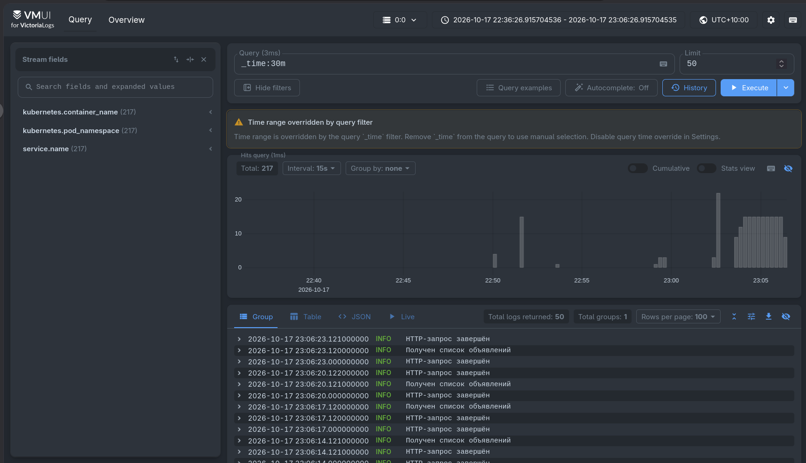
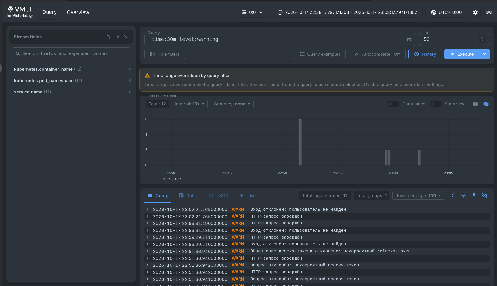
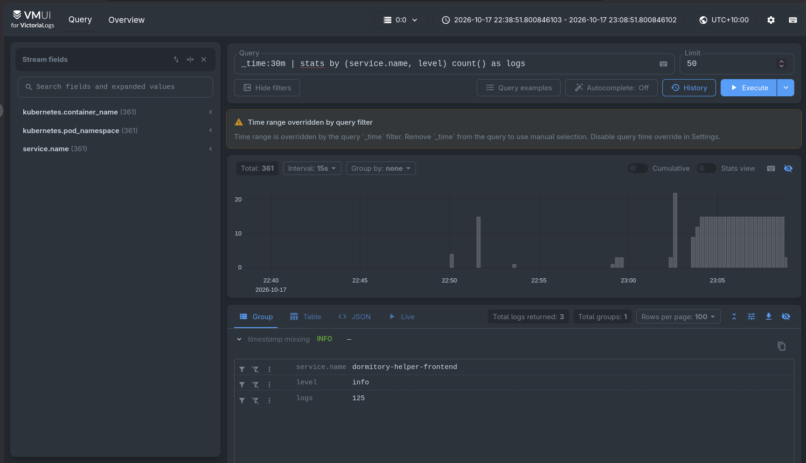
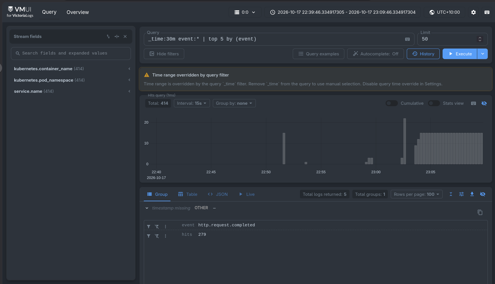

# Отчёт по заданию № 3

## Цель работы

Развернуть VictoriaLogs в Minikube, настроить доставку логов приложения DormitoryHelper и проверить поиск и агрегацию логов с помощью LogsQL.

## Структурированные логи приложения

Backend и frontend записывают логи в стандартный поток вывода контейнеров в формате JSON.

Основные поля логов:

- `timestamp` — время события с точностью до мс;
- `level` — уровень логирования;
- `message` — описание события;
- `service.name` — название сервиса;
- `event` — тип события;
- `request_id` — идентификатор HTTP-запроса;
- `user_id` — идентификатор пользователя;
- `announcement_id` — идентификатор объявления;
- `outcome` и `reason` — результат операции и причина отказа;
- `http.request.method`, `http.response.status_code` и `duration_ms` — данные HTTP-запроса.

Backend записывает бизнес-события регистрации и входа пользователей, обновления токенов, получения профиля и операций с объявлениями. Для неуспешных операций дополнительно сохраняются результат и причина отказа. Пароли, JWT-токены и другие секретные данные в логи не записываются.

Frontend является статическим React-приложением, которое раздаётся через Nginx. Поэтому его контейнерные логи формируются из access-логов Nginx, также настроенных в формате JSON.

## Развёртывание VictoriaLogs

VictoriaLogs развёрнута в single-node режиме с помощью Kubernetes Deployment.

Использованные ресурсы:

- `Deployment` с образом `victoriametrics/victoria-logs:v1.53.0`;
- `Service` типа `ClusterIP` на порту `9428`;
- `PersistentVolumeClaim` размером `2 Gi`;
- срок хранения логов — 7 дней.

Для доступа к веб-интерфейсу используется команда:

```bash
kubectl port-forward service/victoria-logs 9428:9428
```

После этого vmui доступен по адресу:

```text
http://localhost:9428/select/vmui/
```

## Доставка логов

Для доставки логов выбран Vector, развёрнутый в виде DaemonSet. Такой способ не связывает приложение с конкретным хранилищем логов и позволяет собирать логи со всех нод Kubernetes.

Vector выполняет следующие действия:

1. Читает контейнерные логи из `/var/log/pods`.
2. Выбирает Pod backend и frontend по Kubernetes labels.
3. Разбирает содержимое поля `message` как JSON.
4. Добавляет метаданные Kubernetes: имя Pod, контейнера, namespace и образ.
5. Отправляет записи в VictoriaLogs через endpoint `/insert/jsonline`.

В качестве полей потока используются `service.name`, `kubernetes.pod_namespace` и `kubernetes.container_name`. Это позволяет эффективно разделять логи backend и frontend.

Vector получил минимальные RBAC-разрешения на чтение Pod, Node и Namespace.

Выбран именно DaemonSet, потому что один экземпляр Vector запускается на каждой ноде и читает её контейнерные логи без изменения кода приложения. В отличие от sidecar-контейнеров, этот способ не требует добавлять отдельный сборщик в каждый Pod backend и frontend.

## Запуск и удаление ресурсов

Все ресурсы создаются в правильном порядке одной командой:

```bash
make up
```

Для удаления ресурсов используется команда:

```bash
make down
```

## LogsQL-запросы

### 1. Сырые записи за последние 30 минут

```logsql
_time:30m
```

Запрос возвращает исходные записи backend и frontend за последние 30 минут без группировки. На скриншоте отображается 217 записей, содержащих время, уровень, сообщение, название сервиса и метаданные Kubernetes.



### 2. Фильтрация по уровню логирования

```logsql
_time:30m level:warning
```

Запрос выбирает только предупреждения.

На скриншоте найдено 12 записей уровня `warning`. Среди них видны отклонённые попытки входа, запросы с некорректным access-токеном и ошибка обновления токена.



### 3. Количество логов по сервису и уровню

```logsql
_time:30m | stats by (service.name, level) count() as logs
```

Запрос группирует записи по сервису и уровню логирования, после чего подсчитывает количество записей в каждой группе.

На скриншоте результат состоит из трёх групп: информационные логи frontend, информационные логи backend и предупреждения backend. Например, для `dormitory-helper-frontend` с уровнем `info` было подсчитано 125 записей.



### 4. Самые частые события приложения

```logsql
_time:30m event:* | top 5 by (event)
```

Запрос выбирает только записи с полем `event`, группирует их по типу события и возвращает пять наиболее часто встречающихся значений. На скриншоте самым частым событием является `http.request.completed`, которое встретилось 279 раз.




## Состав добавленных манифестов

```text
k8s/
├── vector/
│   ├── configmap.yml
│   ├── daemonset.yml
│   └── rbac.yml
└── victoria-logs/
    ├── deployment.yml
    ├── pvc.yml
    └── service.yml
```
