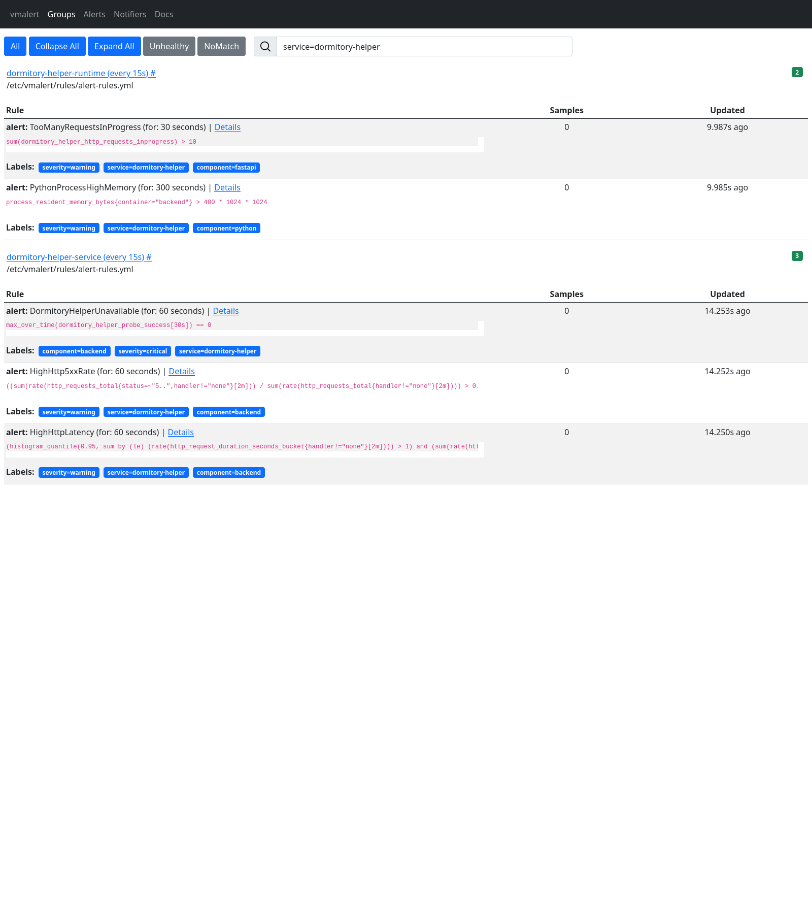
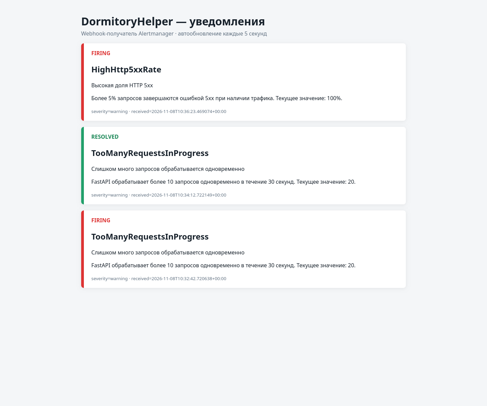
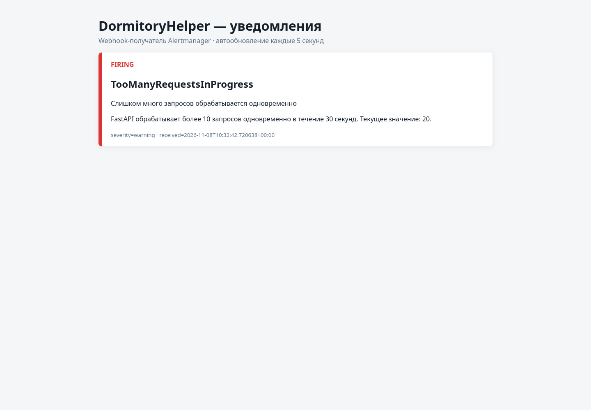

# Домашнее задание № 6. Алертинг DormitoryHelper

## 1. Цель и архитектура

Для DormitoryHelper настроены алерты на прикладные метрики сервиса и метрики
Python/FastAPI. Существующий `vmagent` собирает метрики backend и внешнего
пробера в VictoriaMetrics. Компонент `vmalert` периодически выполняет правила и
передаёт события в Alertmanager. Alertmanager группирует их и отправляет
уведомления получателю.

Для воспроизводимой локальной демонстрации в репозитории есть webhook-получатель
с HTML-страницей. Он получает настоящий вызов от Alertmanager и показывает
уведомления в состояниях `firing` и `resolved` без внешних сервисов и секретов.

## 2. Выбранные алерты

| Алерт | Тип | Условие | Обоснование |
|---|---|---|---|
| `DormitoryHelperUnavailable` | сервис | внешняя проба равна 0 больше минуты | проверяется вся цепочка backend → PostgreSQL, поэтому алерт отражает пользовательскую доступность |
| `HighHttp5xxRate` | сервис | доля 5xx выше 5% при потоке более 0.1 запроса/с | единичная ошибка не создаёт шум, но устойчивая деградация API обнаруживается быстро |
| `HighHttpLatency` | сервис | p95 выше 1 секунды при наличии трафика | порог выше SLI 500 мс и сигнализирует уже о заметной пользователю деградации |
| `TooManyRequestsInProgress` | FastAPI | более 10 одновременных запросов дольше 30 секунд | устойчивый рост конкурентных запросов может означать зависание обработчиков или насыщение пула БД размером 5 |
| `PythonProcessHighMemory` | Python runtime | RSS выше 400 MiB в течение 5 минут | это примерно 80% лимита backend 512 MiB и оставляет время до OOMKill |

Пороговые окна короткие намеренно: это учебный Minikube-стенд. Для production
их следует уточнить по историческим данным и ожидаемому трафику.

## 3. Конфигурация

- [`alert-rules.yml`](alert-rules.yml) — исходные правила MetricsQL/PromQL;
- [`alertmanager.yml`](alertmanager.yml) — маршрутизация и webhook receiver;
- [`k8s/vmalert.yml`](k8s/vmalert.yml) — ConfigMap, Deployment и Service vmalert;
- [`k8s/alertmanager.yml`](k8s/alertmanager.yml) — Alertmanager;
- [`k8s/alert-webhook.yml`](k8s/alert-webhook.yml) — локальный получатель уведомлений.

Alertmanager группирует уведомления по `alertname`, `severity` и `service`.
Critical-алерт подавляет warning для того же сервиса и компонента. Уведомления
о восстановлении (`resolved`) также отправляются.

## 4. Установка и проверка

```bash
./homework-6/deploy.sh
kubectl get pods
```

Интерфейсы открываются отдельными port-forward:

```bash
kubectl port-forward service/vmalert 8880:8880
kubectl port-forward service/alertmanager 9093:9093
kubectl port-forward service/alert-webhook 8080:8080
```

- vmalert: <http://localhost:8880/vmalert/alerts>
- Alertmanager: <http://localhost:9093>
- уведомления: <http://localhost:8080>

## 5. Демонстрация

Для HTTP-сценариев сначала публикуется backend:

```bash
kubectl port-forward service/backend 8000:8000
```

### Ошибки 5xx

```bash
./homework-6/demo-alerts.sh errors
```

Скрипт вызывает существующий учебный endpoint `/demo/work?mode=error`, который
возвращает 503. Через одну минуту правило `HighHttp5xxRate` переходит из
`pending` в `firing`.

### Задержка и конкурентные запросы FastAPI

```bash
./homework-6/demo-alerts.sh slow
```

Двадцать параллельных запросов выполняются по 1.5 секунды. Сценарий создаёт
медленные запросы для проверки `HighHttpLatency` и вызывает framework-алерт
`TooManyRequestsInProgress`.

### Недоступность

```bash
./homework-6/demo-alerts.sh unavailable
```

Скрипт временно масштабирует PostgreSQL до нуля и обязательно восстанавливает
исходное число реплик через `trap`. Пробер получает ошибку `/health/ready`, после
чего срабатывает `DormitoryHelperUnavailable`.

## 6. Скриншоты

### Созданные правила

В `vmalert` загружены две группы: три сервисных и два runtime/framework
правила. На скриншоте видны названия всех пяти правил, их выражения и labels;
обе группы имеют состояние healthy.



### Срабатывание сервисного алерта

Во время сценария `errors` доля ответов 5xx достигла 100%. Правило
`HighHttp5xxRate` перешло в `firing`, было передано в Alertmanager, после чего
Alertmanager отправил уведомление webhook-получателю:



### Срабатывание framework-алерта

Во время сценария `slow` одновременно обрабатывалось 20 запросов. Правило
`TooManyRequestsInProgress` перешло в `firing`, а после завершения нагрузки
Alertmanager отправил отдельное событие `resolved`.



На общем скриншоте уведомлений выше также видно зелёное событие `RESOLVED` для
framework-алерта. Таким образом проверены полный путь доставки и уведомление о
восстановлении.

Исходные PNG-файлы находятся в каталоге `homework-6/screenshots/`.
